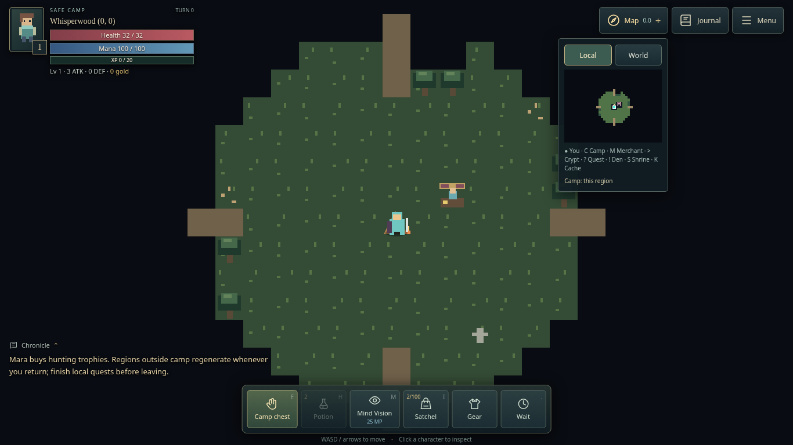
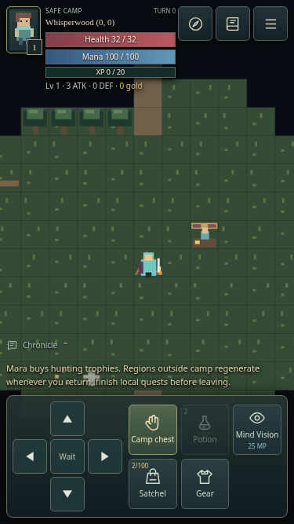
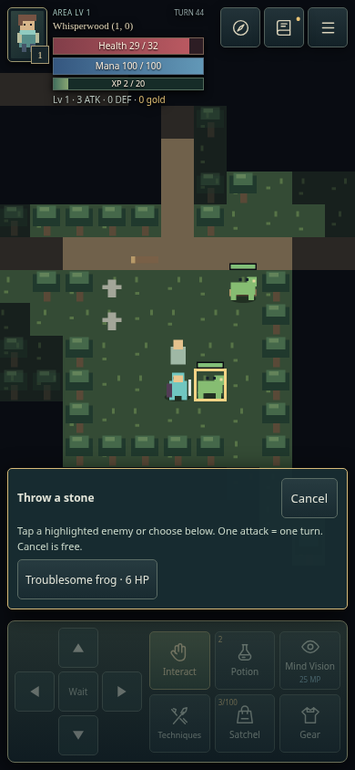
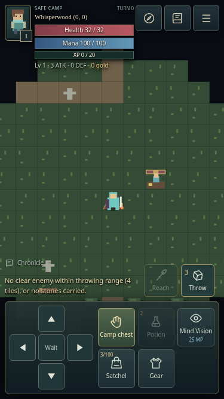
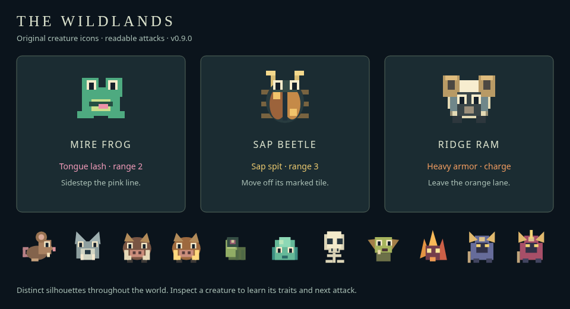

# DungeonCrawler: The Wildlands

A strictly turn-based, original Phaser 3 browser adventure. Explore a remembered wilderness, hunt modest prey, complete local encounters, and return to Lantern Camp to sell trophies and prepare for harder lands.

**Play:** https://flicktrey-oss.github.io/DungeonCrawler/

Look for **v0.18.0 — Bones and keys** and start **New Game** after deployment. The source lives on `feature/playable-roguelike` until merged into `main`.

## Install and run

Use Node.js 22 or newer:

```sh
git clone https://github.com/flicktrey-oss/DungeonCrawler.git
cd DungeonCrawler
git switch feature/playable-roguelike
npm ci
npm run dev
```

Open Vite’s printed address. Existing checkouts can skip cloning. In the restricted cloud home directory use `npm ci --cache /workspace/.npm-cache`. No backend, paid service, art download, or API key is needed.

## Controls

| Desktop | Touch | Action |
| --- | --- | --- |
| WASD / arrows | Direction pad | One tile; bump enemies to attack |
| E | Collect / Trade / Interact / Cook | Loot, camp storage, merchant, encounter, or campfire |
| Enter / `>` | Enter ↓ | Enter a discovered crypt / descend on stairs |
| Q / `<` | Leave ↑ | Retreat while on an upward stair |
| H | Potion | Drink a tonic for up to 16 health |
| 1–3 | Assigned item slots | Use items, equip gear, or target attacks with assigned ammunition/spears |
| M | Vision · 25 | Reveal through walls for three turns, costing 25 Mana |
| G | Map → Local → Detect Creatures | Level 3: mark creatures for two turns, costing 25 Mana |
| Period | Wait | Spend one turn |
| I | Satchel | Arrange, rotate, use, equip, or drop items |
| Esc | Pause / Help | Instructions / pause |

The world waits indefinitely for you. Each valid action costs exactly one turn, followed by one action per living enemy in the current region. Slimes and beetles can spend actions resting. Walking into obstacles or invalid actions is free. Crossing regions and using stairs costs a turn but gives **arrival grace**, so enemies cannot attack before you inspect the destination. Hold a movement key to repeat turns; releasing it stops. Held movement stops before an underleveled border and after crossing any region boundary. Read the warning, then release and press again if you choose to continue. Touch controls and other actions do not repeat. Only the current region is active.

## Slower progression and danger

Start at level 1 with 3 attack, 0 defense, 32 health, two tonics, three throwing stones, and 8 gold. Ordinary woodland rats and beetles award 2 XP; the first level needs 20 XP (ten ordinary kills). Later thresholds increase with level. Levels grant a little health, occasional attack/defense, and a small heal. Quests and stronger foes can accelerate progress.

| Biome | Suggested level |
| --- | ---: |
| Whisperwood | 1 |
| Lantern Marsh | 4 |
| Broken Highlands | 8 |
| Ashen Reach | 12 |

Biomes form seeded patches with local variation; distance from camp no longer determines the biome. Mountains or ashlands can border camp, while forests can appear farther away. The same run seed and coordinates always produce the same biome, regardless of travel order. Creature strength comes from the biome and encounter, with no automatic scaling to the player's level.

Camp remains safe. Every run guarantees one adjacent forest and a connected next region of forest or marsh, providing a starting route without revealing the surrounding world or promising an easy expedition. Iona's first goal points toward that guaranteed forest. Area levels remain visible on phones, and the border HUD names the neighboring biome and its threat before crossing. Arrival grace lets you inspect a destination and retreat. Being able to enter a biome does not mean you can survive it.

Forests form groves and meadows; marshes contain pools/reeds, highlands rocky ridges, and ashlands burned trees. Fallen logs, graves, flowers, bones and other scenery provide visual variation without gathering or crafting.

Ordinary defense has diminishing returns above 3 raw points: every two further points grant one effective DEF. The HUD displays effective protection. Body armor and Reedheart provide ordinary protection; Trail Boots reduce enemy detection by one tile, and Iron Bands add one defense only against telegraphed special attacks. Two Iron Bands can stack that specialized protection. Weathered buckler remains a 35% passive block. Corrosion subtracts one effective DEF after diminishing returns.

## Six discoverable encounters

Each wilderness visit rolls **one or two discoveries**, with an additional traveler quest in forest and marsh regions. Camp is a safe, fixed base with Mara and Trailwarden Iona. Accepted quest regions retain their encounter sites; ordinary enemies still respawn.

| Encounter | Interaction |
| --- | --- |
| Forgotten crypt | Discover its archway, then enter a two-depth dungeon with a dangerous Warden and a rare gear reward |
| Creature den | Challenge a territorial named beast for a hoard using the region’s danger +2 when selecting eligible gear |
| Mirekeeper | Accept a quest to clear three troublesome frogs, return for a Reedheart amulet (+1 defense) and 6 XP |
| Abandoned caravan | Find a coffer guarded by scavengers |
| Wayfarer shrine | Choose one exchange: 5 gold for 12 HP, or 6 HP for 25 Mana; each costs a turn |
| Hidden cache | Follow the grave/cloth marker to buried supplies |

Stand next to the Mirekeeper and press E / Interact. Accepting and claiming are separate turns; reading dialogue is free. Only that encounter’s three frogs count. You can clear them before accepting. Once accepted, you may leave, explore elsewhere, and return later to finish or claim. Open Journal for all accepted quests. The amulet is 2×2 and must be equipped to grant defense. A full satchel leaves the reward claimable.

Shrines reject exchanges you cannot afford, lethal HP payments, and restoring an already full resource. Once used, a shrine is spent for that visit. Common coffers roll the weighted item table or a small purse. Quest, den, crypt and Warden rewards have better equipment modifier odds.

## Persistent maps, returning enemies (v0.8.0)

Each region's terrain, paths, scenery and crypt entrances remain fixed for the run. **Explored tiles stay revealed on the local minimap after leaving and returning**, dimmed when outside current sight. Dungeon layouts, stairs and explored dungeon tiles persist too. New runs still create a newly randomized world.

In a region without an accepted quest, re-entering respawns enemies and rerolls non-crypt discoveries: villagers, dens, caravans, shrines and caches can appear at different valid locations or be absent. Quest placement varies between regions, visits and run seeds; it is not locked to one sector. People and encounters are placed on existing reachable terrain without carving new trails. New encounters on previously explored ground are hidden until rediscovered, so remembered maps do not reveal fresh rewards remotely.

Accepted quests retain their givers, encounter sites, objectives, special enemies (including wounds/deaths), ground items and progress across travel, including after reward collection. Ordinary creatures in those regions still respawn. Unaccepted, unpinned regions refresh their local offers and loose loot. Claimed character rewards stay yours. Crypt foes and loot also respawn on re-entry. Stable surface entrances and dungeon stairs make return journeys predictable; arrival always chooses a vacant walkable tile with no immediate enemy turn. Camp terrain, stored supplies and merchant stock remain stable throughout the run.

The World map remembers visited coordinates and discovered, fixed crypt entrances. **Memory lasts for the current run only**: death, refresh or closing the browser still ends the run; no save system was added.

## Gold, drops and merchant

Creatures do not always drop loot: 50% drop nothing, 25% roll 2–4 coins, 17% drop a low-value trophy, and 8% roll the weighted item table (locked items become coins). Loot remains on the ground and must be collected. Brush-rat fangs sell for 2 gold; frog pearls for 3. Coins do not occupy inventory cells.

Mara stands two tiles east and one north of the tent. From the starting position, walk **two steps east**, then E / Trade. Buy tonics (10 gold, three per run), a worn shortsword (+1 attack, 8 gold), a trail spear (+1 Reach, no attack bonus, 35 gold), a weathered buckler (35% passive block, 12 gold), throwing stones (3 for 4 gold), patched vest (+1 defense, 10 gold), Trail Boots (reduced detection, 8 gold), or Iron Bands (special-attack protection, 12 gold, two available). Sell carried items from the same dialogue. Unequip equipped gear before selling it. Trading costs one turn per successful transaction; browsing is free. Stock does not replenish on travel.

## The 10×10 satchel

Open **I** or **Satchel** in the bottom action dock.

- Potions and trophies: **1×1**. Stones stack up to nine in **1×1**; overflow needs another cell.
- Swords/spears: **7×2**, rotatable to **2×7**.
- Armor: **4×4**.
- Amulets: **2×2**. Bucklers: **3×3**.

Select an item, then tap an empty cell or set a one-based Column/Row and press Place item. Rotate item changes the planned orientation; choose a destination to commit it. Rearranging is free and does not advance enemies. Using, equipping or dropping costs a turn.

Capacity depends on contiguous shape, not just the number of free cells. Pickups, purchases, retrieval, quest rewards and equipment swaps check fit before committing. Failures leave ground items, money, stock, stored items and rewards intact. Camp storage is not spatially limited. Bag inspection also offers **Pick up item here**, so items dropped at camp or beside the merchant remain recoverable even where E normally opens another dialogue.

## Maps, Mana and permadeath

Local and World tabs switch the same minimap canvas. Local shows explored tiles and discovered features. World shows visited regions, biome colors, camp, your region, discovered entrances, and accepted quest destinations (unvisited destinations stay neutral). Minimize/restore with Map − / +; switching costs no turns.

Mana begins at 100. Mind Vision costs 25 and lasts for the casting turn plus two further completed turns. Every completed turn restores 0.3 Mana, including waiting and casting; invalid actions and idle time restore none. Recovery bonuses on the Lantern Relic and Amber Moth add 0.2 each. Detect Creatures unlocks at level 3: press G or use its button in the Map panel to spend 25 Mana and mark all living creatures on the current local minimap for the casting turn plus one further turn, without revealing terrain or hidden actors. Transitions end the effect. Revealed terrain stays mapped for the rest of the run, including when you leave a region.

**There is no save system.** Death ends the run, including camp storage. Refreshing, closing the page or Safari unloading it also loses the run. The slower progression is intended for longer runs, not cross-session persistence yet. No construction, crafting, hunger, gathering, farming systems, multiplayer, or paid services were added.

## Verify

```sh
npm test
npm run build
npm run preview
# Optional browser suite:
npx playwright install chromium
npm run test:browser
# Existing Linux Chromium:
CHROMIUM_PATH=/usr/bin/chromium npm run test:browser
```

Validation is run with `npm test`, `npm run test:browser`, and `npm run build`. Coverage includes all generated walkable tiles/exits across seeded samples, spawn uniqueness, turn accounting, persistent maps and respawns, slow leveling, loot outcomes, all six encounters, quest completion, shop purchases/sales, inventory footprints/rotation/full-bag transactions, and phone gestures/layout. Browser fixtures use actual inputs against a deterministic simulation, without injecting character state. One browser run completes the frog quest, sells its reward and buys a tonic; another rearranges and drops/recovers inventory on a phone layout.

Phone tests are Chromium touch emulation. Actual iPhone Safari remains a manual check; WebKit download was blocked by the environment. Balance is a first pass, not an exhaustive long-run playtest. Art is simple original procedural pixel-style drawing. There is no sound. Vite reports the expected large Phaser bundle warning.

## Architecture and publishing

`src/game/expedition.js` is the current mode, extending the original dungeon-only `Game`. `world.js` builds terrain and encounter sites; `encounters.js` defines the six types and treasure; `inventory.js` owns spatial capacity; `merchant.js` owns stock and purchasing. Combat, items, visibility, AI, seeded RNG and the central turn manager remain independent of Phaser. `ui-icons.js` provides original inline HUD icons and `version.js` the release label. `inventory-ui.js` provides the grid editor; `main.js` handles dialogues/HUD/input; `render/scene.js` draws snapshots; `minimap.js` owns both map views.

GitHub Pages uses **Source: GitHub Actions**, with `feature/playable-roguelike` allowed by the `github-pages` environment. Source pushes trigger testing/building and official Pages artifact deployment. The public URL changes only after a successful workflow; a Git push alone does not verify publication. Relative asset URLs support `/DungeonCrawler/`. The historical `gh-pages` branch is not the active deployment source.

## Character equipment screen (v0.5.1)

Open **I → Equipment**, or choose **Gear** in the bottom dock (the portrait at upper left opens equipment too). Satchel and Equipment are separate tabs in the same popup. A character portrait shows your equipped weapon in hand, buckler in the off hand, armor on the torso, and an amulet at the neck. Tap a slot to inspect its item and bonus, then use its Unequip button. Carried equipment is listed below the portrait with Equip buttons. The same character changes appearance in the world, HUD and inspection. Boots and two ring slots are included; off-hand relics replace shields. Select either ring slot before equipping to choose which ring to replace.

Equipped items remain in their satchel cells with a green highlight and check mark. They still count toward the 100-cell capacity. Unequipping clears the equipment slot without adding another copy or changing the bag footprint, even when the bag is full. One item cannot fill two slots. Unequip before dropping, selling or storing an item. Equipment changes update attack/defense and consume one turn; looking and switching tabs are free. If enemies are nearby, they act after each successful equipment change.

Touch actions commit once through the native click after a valid release, preventing a compatibility click from immediately activating newly opened dialogs. Dragged, canceled and ambiguous two-finger gestures spend no turns. Keyboard and assistive activation are supported. The desktop and phone browser suites complete a real frog quest, equip its amulet, verify the neck icon and defense bonus, then unequip and verify that the bag item returns.

## Full-screen expedition HUD (v0.6.0)

The world fills the browser viewport with no page scrolling. Status bars sit at upper left in Health → Mana → XP order, with level, combat stats, gold and area danger visible. The camera scales sprites for the device and keeps the adventurer centered, including near region edges.

- **Top right:** Map (Local / World), Journal (all accepted quests), and Menu (pause/help). Map and Journal open separately so their panels do not cover each other. The minimap starts expanded on desktop and collapsed on phones.
- **Bottom:** a fixed action dock for context-sensitive Interact / Collect, Potion (with carried count), Mind Vision (with Mana cost), Satchel (with occupied cells), Gear and Wait. Enter / Leave appears when standing at the appropriate stairs. Keyboard shortcuts are shown on desktop.
- **Events:** the latest event stays visible above the dock. Open Chronicle for scrollable history; it starts collapsed to keep the world clear.
- **Touch:** a directional pad sits beside the dock in portrait and beside the action buttons in landscape. All active targets are at least 44 pixels. The layout accounts for iPhone safe areas. Touch gestures still commit once per valid tap.
- **Inspection:** click/tap a visible character for its live portrait and stats card; × closes it. The card stays out of the central player position.

Panels and menus scroll internally when needed. Opening them stops held movement; viewing never costs a turn. Dialogs support keyboard focus and Escape to return. The release label appears in Menu and the title screen, both from `src/version.js`.




## Held keyboard movement (v0.5.3)

Hold WASD or an arrow key to keep stepping: one immediate action, a 300 ms initial delay, then one action every 150 ms. Each valid step or bump attack advances exactly one turn; walls still cost no turn. Release to stop. Menus, clicking controls, switching tabs, and losing window focus cancel held movement. Underleveled border warnings and crossing a region boundary also cancel held movement. After cancellation, release and press again to move. Only the most recently pressed direction repeats; other actions and touch controls remain one action per press/tap.

## Enemy health bars (v0.5.4)

Visible living enemies have a small health bar above their sprite. Bars shrink as damage is dealt and change from green to amber to red as health runs low. Hidden enemies remain hidden; defeated enemies and their bars disappear. Each bar shows remaining health as a proportion of that creature's maximum, rather than a comparison of its attack strength.

## Character inspection (v0.5.5)

Click or tap a visible character on the main map to open a compact portrait card with race/creature type, Strength (attack), Defense and current/maximum Health. The adventurer's stats include equipped gear. Merchant and quest-giver cards show Human / Noncombatant with no invented combat stats. Inspection costs no turn; the card updates as combat proceeds and closes if the creature dies or leaves sight. Click empty ground or × to dismiss. Hidden characters cannot be inspected.

## Field equipment and techniques (v0.7.0)

Each new run starts with three throwing stones in addition to two tonics. Main-hand, off-hand, body and neck slots are available in Gear. Bump attacks remain the default adjacent melee action. Techniques use equipment, not Mana:

| Equipment | Technique / tradeoff |
| --- | --- |
| Worn shortsword | +1 attack to adjacent strikes; 7×2 cells |
| Trail spear | Base attack, **+1 Reach**: 1–2 tiles along a clear cardinal line; 7×2 cells |
| Weathered buckler | Off-hand, **35% chance to block each incoming attack completely**, without an action; 3×3 cells |
| Throwing stones | **Throw** within a four-tile circular range for 2 damage before defense, minimum 1; consumes one stone with 50% chance of landing intact |

Assign a spear or ammunition to item slots **1–3**. An equipped spear opens Reach targeting; ammunition opens Throw targeting. Slot 1 starts with throwing stones and shows the carried quantity. The fixed Reach/Throw buttons and R/T shortcuts have been removed. Main-hand and off-hand equipment can be used together. Higher-tier Iron-tipped spears also offer Reach.

Selecting Reach/Throw highlights legal enemies. Click/tap a highlighted creature or select its named target button. A valid attack spends exactly one turn; invalid targets, opening the chooser, Cancel and Escape are free. Movement is blocked during targeting. Walls, trees, rocks, NPCs and intervening living enemies block the shot; diagonal throws cannot cut solid corners. Mind Vision does not let weapons strike through walls. Targeting closes after a successful attack.

An equipped Weathered buckler rolls a seeded **35% block chance per incoming attack**. A block prevents all damage from that hit; an unblocked hit uses normal armor/defense. Attacking, moving or using items does not disable the shield. Unequipping immediately removes the chance. Blocks flash the portrait and show “Blocked!” in the event log. There is no Brace action or B shortcut. Every completed turn restores 0.3 Mana; relevant relics/charms add 0.2 each.

Stones that survive land on the target tile (even if the creature dies); collect them after the fight. Pickups and purchases merge stacks up to nine, preserving both items and gold if overflow cannot fit. Selling a bundle pays one gold per remaining stone. Basic gear can appear rarely on enemies and in early coffers, while higher-tier rewards remain in dangerous areas. Later releases add hatchets, boots and two ring slots; see the current item table for their effects. Helmets and gloves remain deferred.



## Passive buckler and quick slots (v0.7.1)

Brace has been replaced by passive shield blocks. Equip Weathered buckler in Gear → Off hand for 35% block chance per incoming attack. Reach and Throw are now accessed through assigned item slots; there are no fixed technique buttons. Target selection remains free and requires a deliberate target confirmation; a valid attack takes one turn.



## Creature personalities (v0.9.0)

Enemies now use original expressive 24px creature icons, rather than one shared animal silhouette. World sprites and inspection portraits use the same renderer. Rats have ears and curled tails, frogs have wide eyes and feet, beetles have split shells and antennae, rams have horns and armor, and the other creatures have distinct silhouettes and palettes. No external sprites, platform emoji fonts or downloaded assets are required.

| Creature | Attack style | Counterplay |
| --- | --- | --- |
| Mire / Troublesome frog | Winds up **Tongue lash**, a clear cardinal line up to **2 tiles** | Pink warning tiles show the lane. Sidestep before its next enemy phase. |
| Sap beetle | Marks a tile for **Sap spit**, range **3**, then fires next phase; bites when adjacent | Move off the amber cross. The projectile targets the marked tile, rather than tracking you. |
| Ridge ram | **5 base defense**, adjacent headbutts, and a telegraphed straight charge up to **3 tiles** | Leave the orange lane; walls and creatures stop the charge. The ram cannot overlap the player or another creature. |

Warnings resolve only after another valid player action. Idle time, inspection and rejected wall moves do not advance them. Killing a preparing enemy cancels its attack. Tongues and sap require a clear line; Mind Vision does not allow attacks through walls. Bucklers can block all three attack types. Damaging attacks still use ordinary attack/defense calculations, and prepared moves consume one enemy action rather than adding extra attacks.

Click/tap an enemy to read its traits and current preparation. Warning colors are paired with different marks, inspection text and Chronicle messages. Pink tongue trails, amber sap shots and orange charge paths provide combat feedback; rendering has no effect on turn rules.



## Loot and wardrobe update

The 27-item roster adds boots, two ring slots, off-hand relics, consumables and alternate ammunition. Difficult encounters offer substantially better modifier odds than ordinary kills. Dens favor weapons/boots; crypts favor protection/relics. Start in ragged clothes; equipped gear changes your original pixel character in the world and popup. Plain equipment is affordable early; ideal combinations remain uncommon. The roughly 20-minute pacing target still needs player feedback.

See [the full item table, source odds and mechanics](docs/loot-and-wardrobe.md). Choose supplies from the Satchel; use the Throw selector for stones, knives or thunderstones. Opening panels, selecting ammo and rearranging inventory remain free. No save/load is added.


## Wandering quests (v0.11.0)

Walk two tiles west from the starting campfire, stand beside **Trailwarden Iona**, and use E / Interact. Each seeded run gives her a different hunt, recovery or waystone goal in the guaranteed neighboring forest. Other neighboring regions can be much more dangerous. Her reward is collected back at camp.

Forest and marsh travelers offer:
- **Beast on the Trail:** defeat a named, stronger creature and return for Trail Boots.
- **The Stolen Keepsake:** defeat two guards, collect the keepsake, and return for an Iron Band. The keepsake is recorded in the Journal without using satchel cells.
- **The Broken Ward:** rekindle three waystones (stand on each and Interact), defeat the awakened Briar Sentinel, and return for a Lantern Relic.

Quest equipment uses the existing quest modifier odds (70% modified, with exceptional combinations uncommon). The existing frog-clearing quest also persists once accepted. Several quests may stay active together, with no timers, level gates or travel penalties. Each successful acceptance, activation, collection or claim takes one turn; browsing and Journal tracking are free. Rewards are granted once, and a full satchel leaves the exact reward claimable later.

Open **Journal** to see progress, objective region, suggested biome level, and where to return. Track one quest to highlight it within the Journal and brighten its World minimap marker; unvisited quest destinations remain neutral and reveal no terrain. Quest targets have a small gold marker when visible. Quest-givers have colored clothing and inspection names.

Quest persistence lasts only for the current run. Death or refreshing still ends it; no cross-session save/load has been added. Escort quests, cross-region search chains and additional templates are deferred.


## Woodland discoveries (v0.12.0)

Whisperwood has connected meadows and fewer trees (about 19% fewer tree tiles across a 100-seed comparison, including boundaries). Other biomes keep their existing terrain.

Each non-camp forest region rolls an independent **50% chance** of one extra noncombat encounter, in addition to its quests and usual discoveries:
- **Nessa the Herbalist:** one tonic for 6 gold or one hunting trophy.
- **A Wounded Traveler:** give one Ember tonic for 8 gold.
- **Forgotten Milestone:** read a truthful nearby crypt-region clue. Its terrain and entrance remain undiscovered until you explore there.

Stand beside the people, or on the milestone, and use **E / Interact**. Browsing costs no turns; a successful exchange, helping action or reading costs one turn. Declining is free. These sites and outcomes last for the run, with no repeat rewards. Regions with an extra encounter retain their encounter layer on return; ordinary enemies still respawn.

The **World** minimap now places gold **!** markers inside regions with accepted quest objectives. On completion, the marker moves to the reward giver's region and becomes **✓**. Claiming removes that quest's marker. Multiple quests in a region are grouped; tracking brightens its marker. A quest pointing to an unvisited region adds a neutral square without revealing terrain, creatures or entrances. Purple entrance indicators and the current-region border remain separate.


## Uncharted trails (v0.13.0)

World geography is no longer a sequence of biome rings. Seeded patches and local variation create different routes each run, including dangerous regions beside camp. One adjacent forest and a connected forest/marsh frontier guarantee a foothold. The rest of the route must be discovered and judged through border warnings, terrain, enemy inspection and the World minimap.

Special encounters remain dangerous within familiar biomes. Named quest hunts and awakened waystone sentinels have two more attack than before; den guardians gain two attack and four health. Den hoards roll eligible equipment at the region's danger plus two, rewarding the extra risk without handing stronger equipment to every ordinary creature.

Dens, marked beasts, keepsake guards and awakened sentinels occupy warning territories with a five-tile Manhattan radius. Warning boundaries identify local danger when their guardians are visible, and the HUD warns when you enter a pocket. These guardians disengage and return toward their territory when you step beyond it; a pending special attack does not follow you outside. Ordinary roaming enemies still behave normally. You can choose another route, improve your equipment, or return later.

Equipment defense is less cumulative: armor supplies the main flat protection, boots help avoid detection, rings can specialize against special attacks, and ordinary defense softens above three. Strong geography and encounters retain their strength as your character levels. Reading warnings and preserving an escape route matter throughout the run.

## Satchel icons (v0.13.1)

Items in the 10×10 satchel use emoji artwork: swords, spears, shields, boots, rings, necklaces, tonics, food, stones, trophies and relics. Stack counts appear as small badges. Tap an icon for the full name, description and item controls; desktop hover also shows its name and quantity. Icons follow the item family even when loot has a modifier. Emoji appearance varies with the device font.

## Click to explore (v0.14.0)

On desktop, click a visible empty tile to walk there using explored paths. Click a loose item to walk over and collect it, a friendly person to approach and open their dialogue, or a camp, shrine or crypt entrance to use it on arrival. Walking takes one turn per tile; collecting an item takes another turn. Dialogue still lets you choose whether to buy or accept anything. Mint dots mark the remaining route.

Travel stops for nearby threats, newly revealed enemies, attacks (including blocked attacks), blocked paths and region changes. Escape, manual input, opening a menu or leaving the browser tab also cancels it. It never automatically attacks. Click a creature to inspect it; Shift-click a friendly person to inspect instead of approaching. Phone taps retain character inspection and ability targeting; use the directional touch controls to move.

## Campfire provisions (v0.15.0)

- Equipment keeps occupying the same satchel cells while worn. Green tiles with a check mark identify equipped items. Select one to unequip it, or use the Equipment tab.
- Bramble rabbits inhabit forests. Rabbits drop one raw meat with a 50% chance; Mire frogs and Troublesome frogs have a 35% chance; otherwise nothing. They no longer drop coins, trophies or random equipment. Quest rewards remain separate.
- The **F campfire** is one tile south of the starting tent. Stand on it and use **E / Cook**, or click it on desktop. Cook one raw meat per turn. Raw and cooked meat each stack to nine per 1×1 cell. Cooking fails without consuming ingredients if the result cannot fit.
- Select **Campfire meat 🍖** in the Satchel and use it to restore 10 HP (tonics restore 16). Eating uses one piece and one turn; full health does not waste food. Raw meat must be cooked first.
- Base Mana regeneration is **0.3 per completed turn**, including waiting. Ability costs are deducted before that turn’s regeneration; for example a 25-Mana cast from 100 leaves 75.3 Mana.
- **Detect Creatures** unlocks at level 3. Press **G** or open **Map → Local → Detect Creatures**. It costs 25 Mana and marks living creatures in pink for two turns, including the casting turn. It reveals neither terrain nor creatures on the main canvas. Changing regions ends detection.

## Rat trail food (v0.15.1)

Brush rats now drop raw rat meat with a 50% chance, otherwise nothing: no coins, trophies or equipment. Choose **Cook rat meat** at the starting campfire, then eat **Rat meat** from the Satchel for 5 HP. Raw and cooked rat meat each stack to nine per 1×1 cell, separately from regular meat. Cooking and eating each cost one turn; full bags or full-health uses never waste supplies.

## Main story: The Road to Northwatch (v0.16.0)

Prince Aldren’s convoy was ambushed on the southern road. He shelters southeast of the Lantern Camp tent at tile (24, 17), wearing mail and carrying a sword. Trailwarden Iona and all side quests remain available.

- **Start whenever ready.** Stand next to Aldren and use **E / Speak**, or click him on desktop. Browsing is free. **Begin escort** takes one turn; there is no level requirement, timer, or forced departure. Prepare supplies and gear locally first if you wish.
- **Follow / Stay.** He takes at most one action after each valid player action, before enemies. He follows using paths and defends himself against adjacent enemies without chasing them. He has 36 HP, 5 attack and 2 defense. Commands take one turn. Walk into him to swap places safely. Shift-click or tap him for a free portrait/stat inspection.
- **Crossings.** A following prince must be within two tiles for region or crypt crossings. Wait for him if he falls behind. He crosses with you onto a vacant tile, with arrival grace. Stay leaves him in that region, including crypt depth; return beside him to resume. Inactive regions stay frozen. The Journal records his region, health and orders; his last known tile remains gold on explored local maps.
- **Wounds.** Enemies can target Aldren. At zero health he becomes downed and waits for aid. Give a healing tonic from his dialogue to restore 16 HP, then ask him to follow. Tonics are consumed and aid takes a turn. Player death still ends the entire run; there is no save/load.
- **Destination.** Reach **Northwatch (0, -6)**, six regions north of camp, then escort him to its northern keep at tile (20, 7). Each seed has a connected route through forest and marsh (up to recommended level 4); surrounding regions retain stronger biomes and dangerous pockets. The route can involve detours. Accepted main quests mark the destination on the world map without revealing its terrain. You can track it again in the Journal.
- **Chapter one complete.** Arrival together at the keep awards 30 gold and full recovery once. Aldren stays in the city; dismiss the chapter popup to keep exploring. Northwatch is a safe stone city with walls, gates, paved streets, enterable buildings and a keep. An inn, innkeeper, bounty board and rescued residents are available. Other city shops and later chapters are deferred.

The escort is an optional story within the same permadeath expedition, rather than a separate difficulty mode. All companion rules run through the central turn manager; elapsed time never moves the prince or enemies.

## Better hunting (v0.16.1)

Rats and rabbits now drop meat 50% of the time; frogs remain at 35%. Successful meat drops are announced in the Chronicle and shown as a distinct steak-and-bone sprite on the ground. Drops still need collecting and cooking; food healing and stack sizes are unchanged.

## Roads and townsfolk (v0.17.0)

- **Any-item quick slots:** select any satchel item and choose Assign to quick slot 1, 2 or 3. Assignment and clearing are free. The three emoji buttons use keyboard shortcuts **1–3**. Consumables are used, ammunition opens targeting, equipment equips/unequips (equipped spears open Reach targeting), and raw materials/trophies open their description. Identical replenished supplies reconnect to their slot. Missing supplies disable it. Worn gear is green.
- **Cook All:** the campfire processes both meat types, one turn per piece, stopping when output cannot fit. No ingredient is lost on failure.
- **Equipment comparisons:** satchel selections and equipment listings preview attack, effective/raw defense, block chances, reach, Mana, stealth and special protection. Replacement and new ability descriptions appear together. Ring previews respect the selected slot.
- **Animal tracks:** discover fixed footprint trails near hunting grounds and dens. They suggest a place to investigate, not live creature positions; old tracks persist with terrain.
- **Better tough-encounter rewards:** hunt-quest and town-bounty rewards always receive a modifier (85% useful, 14% powerful, 1% exceptional). Den equipment has 15% plain, 65% useful, 19% powerful, 1% exceptional odds. General enemy stats and ordinary loot are unchanged.
- **Northwatch inn:** the west building has a bed marked **I**, an open south doorway and **Maren the Innkeeper**. Visit the bed or speak beside Maren to pay 6 gold for full health and Mana. Full recovery is not sold when already full.
- **Bounty board:** use **E / Visit** on **B** near the fountain. Three optional hunts count rats, Mire frogs or wolves killed after acceptance. Accepted bounties appear in the Journal and have no timer. Return to the board for modified equipment plus 8 gold. Rewards are once per run and remain claimable if the bag is full.
- **Rescued residents and choices:** a wounded woodland traveler accepts a tonic (8 gold thanks) or cooked regular meat (4 gold thanks). Up to three rescued travelers appear in Northwatch on your next arrival and remember your help. Existing herbalist gold/trophy choices remain. More complex alternate quest resolutions are future additions.
- **Creature index:** open Journal → Creature index. Only directly seen species are recorded, with portraits, observed biomes, attacks, drop hints and kill counts. Detection does not reveal entries through fog.
- **Death recap:** Game Over records the killing blow and a turn-by-turn history of recent actions and events. Retry this seed starts a fresh character in the same seeded world. The history uses game turns, not elapsed seconds.
- **Distinct people:** named people have original adventurer-like bodies, varied hair, skin, clothing and hats. Iona and wardens carry protective gear; Nessa carries herbs; Mara has merchant clothing and a satchel. Inspection portraits match each person.

Shove and extra prince dialogue are intentionally excluded. All of these features remain within one permadeath run; no save system, crafting tree or persistent power progression is introduced.

## Bones and keys (v0.18.0)

The action dock now has only the three configurable item slots. Slot 1 initially contains throwing stones. Pin a spear from the satchel; press its slot to equip it, then press again to select a Reach target. Select targets deliberately; opening/canceling targeting is free. Other gear retains its equip/unequip behavior.

**Orren the Grave Keeper** stands southwest of the tent at (16, 18), next to bones and a gravestone. Walk beside him and use **E / Trade bones**, or click him on desktop. Skeletons drop one **Old bones** stack item with a 50% chance; otherwise their ordinary loot roll applies. Bones stack to nine per cell.

Trade **five bones for one skeleton key**, costing one turn. The trade is repeatable and checks output space before consuming anything. Keys stack to nine. A new **Locked reliquary** on each crypt depth two contains a valuable equipment reward. Collect/open it using a key; one key and one turn are consumed only after the treasure fits. Locked coffers remain in place on insufficient keys or inventory space, and their reward does not reroll after a failed attempt.

## v0.19.0 — Read the battle

This release focuses on combat readability and weapon choices:

- Visible special attacks show a text warning under your stats, including whether you are in the marked path. Colors and shapes identify tongue lines, sap crosses, charge lanes, and violet warden sweeps. Warnings remain frozen until your next valid action.
- Boars and Bristlebacks now prepare straight charges. Crypt/Ash Wardens prepare a sweep of their four adjacent tiles. Charges and sweeps leave one enemy action of recovery afterward, shown by a teal ring with pause marks. Step out of the warning, then use the opening.
- Swords gain **Countercut: +1 melee damage against an enemy preparing a special attack**. This does not cancel its attack: decide whether the hit is worth the risk.
- Hatchets ignore one defense normally, or two against enemies with at least three defense. Spears retain clear cardinal reach of two tiles; thrown supplies remain expendable ranged options. Equipment descriptions include the rules, including modified loot.
- Brief floating damage, countercut labels, hit marks, block shields, and miss feedback make outcomes visible on the map. Effects never spend turns, gate input, or change combat rules. Reduced-motion settings suppress floating movement. No downloaded art or sound assets.

Balance remains a playtesting task: these mechanics provide readable opportunities, rather than a guarantee that every loadout can beat every region. This is the first combat-focused batch of the improvement roadmap; additional quests, townspeople, exploration content, and audio are future work.

## v0.20.0 — Trails and guardians

- **A marsh foothold:** ordinary marsh populations include four small pond frogs near the coordinate-aligned main trails, at starter strength. Up to three stronger frogs/leeches defend marked side pools, remain inside their territories, and do not chase onto the main trail. Dens and quest encounters are still dangerous; the region recommendation remains level 4. Mountains retain their higher difficulty.
- **Three den owners:** Old Bristleback in forests charges in a marked line; Reedmaw in marshes prepares a three-tile tongue lash; Cairnhorn in highlands/ashlands marks an eight-neighbor stomp. All have a recovery action to exploit, original portrait details, visible territorial boundaries, and their own discovered-creature journal entries. Dens use the existing randomized encounter slots.
- **Themed hoards:** a defeated den owner guarantees modified equipment: 60% useful, 35% powerful, 5% exceptional. Bristleback favors hunting weapons/boots, Reedmaw favors spears/shields, Cairnhorn favors armor/protection/hatchets. Ordinary surface loot odds are unchanged.
- **Crypt completion rewards:** each depth-two Warden’s first defeat guarantees one powerful dungeon-only item: Ossuary Lantern, Cryptstep Boots, or Warden’s Spire. Each has a distinct equipment tradeoff and can be equipped, compared, sold, and assigned to quickslots normally. These three items are outside the ordinary surface loot pool.
- **Remembered crypt treasure:** crypt supplies, collected chests, unclaimed rewards, dropped items, and first-clear status persist for the run. Leaving does not reroll a prize or restore looted supplies. Enemies still repopulate; a new run resets everything. Skeleton-key reliquaries remain separate bonus rewards.

Play the revised marsh edges, use inspection to learn den-owner attacks, and prepare before entering side pools or crypts. This release focuses on difficulty transitions and meaningful encounter rewards; later roadmap items remain future work.

## v0.21.0 — The Willow Crossing

Your guaranteed neighboring forest now contains a river bridge held by Kestrel’s Willow Band. A longer dry detour remains available: this encounter cannot lock you out of exploration or the prince’s journey.

Approach Kestrel and press **E / Interact**, or click the keeper to approach and talk. Browsing dialogue is free. Choose one solution:

- **Pay 8 gold:** opens the crossing immediately, using one turn.
- **Recover medicine:** accept the errand for one turn, clear the small guarded medicine site, collect its pouch for one turn, then return it for one turn. The Journal and local minimap mark the objective. The pouch needs no satchel space; returning it awards 4 XP. No deadline. You may switch to payment or fighting before resolving the errand.
- **Fight:** starts a fight with two human guards for one turn, after which they act. Both must fall before the barrier opens. Once combat begins, the guards will not negotiate.

The open bridge provides a shorter physical route for both you and Aldren. Payment, unfinished errands, medicine, hostile guards, defeated guards, and the opened crossing persist when leaving and returning. New runs reset the encounter. Failed payments and bumping the closed gate do not consume turns. The encounter uses original procedural bridge, barrier, medicine-pouch and bandit graphics.

## v0.22.0 — Choose your action

When several interactions are available at your tile, the action dock shows **Next action** and a counter such as **1/3**. Tap it, or press **F**, to cycle between speaking, trading, storage, cooking, and each individual item on the ground. The main action button shows the selected person/item; tap it or press **E** to perform that action. Cycling is free and never advances enemies. Moving resets the selection. Clicking a specific person or item still targets that person/item directly.

## v0.23.0 — The northern road

- **A lead from camp:** Scout Fen stands northeast of the tent at local tile (25, 12). Speak to him and choose **Mark Willow Crossing**. For one turn he marks the bridge’s region with **B** and the Fallen Watchtower with **◇** on the world map. These clues reveal no terrain and do not count as visits. The Journal remembers them.
- **Three road landmarks:** the seeded road toward Northwatch now has a Fallen Watchtower, Reedstone Causeway, and Last Lantern Shelter in three distinct regions. Their terrain persists and the crossings remain connected to all four exits. Each offers one optional choice per run, with no deadline.
- **Watchtower:** scout the road to mark all three landmarks, or take its last Ember tonic.
- **Causeway:** help a nearby, living, wounded Aldren recover 8 health, or recover a purse worth 4 gold.
- **Shelter:** restore up to 8 health to yourself and nearby Aldren, or take Honeyed Rations for later. A rest at full health is free and does not spend the landmark’s choice.
- **A homecoming:** reach the northern keep with Aldren to receive 30 gold, full health/Mana recovery, and **Aldren’s Wayfarer Brooch**. The amulet grants +10 maximum Mana and +1 protection against special attacks. It stays in your satchel until you choose to equip it. Steward Elara holds it inside the keep if it will not fit; claiming it later takes one turn and cannot duplicate it.
- **Your journey acknowledged:** the welcome reflects how you resolved Willow Crossing, your landmark choices, and tonic aid given to Aldren. Blue-and-gold keep banners and Elara’s dialogue remain after arrival. You can continue exploring.

These additions preserve the existing open world, optional escort, alternative routes, permadeath, and strictly turn-based actions. A new run resets the road choices and rewards.

## v0.24.0 — Roll the damage

Combat now rolls bounded damage for each successful hit, using a dedicated random stream seeded from the run. All values below are before enemy defense and conditional bonuses:

- **Swords:** current attack −1 to +1. A starting Worn shortsword gives **3–5** damage.
- **Spears:** current attack −1 to current attack. A starting Trail spear gives **2–3**, with its existing two-tile reach.
- **Axes:** current attack −2 to +2. A starting Woodcutter’s Hatchet gives **1–5**, plus its existing armor piercing. Higher strength and weapon modifiers shift the entire range.
- **Unarmed:** fixed damage from your attack stat.
- **Projectiles:** stones deal **1–3**, knives **3–5**, before defense. Thunderstones still interrupt without dealing damage.
- **Enemies:** attacks of strength 3 or less roll from one below strength up to strength; stronger enemies roll strength ±1. Telegraphed attacks use the same narrow band, with special protection applied normally. No critical hits or random misses were added.

The HUD shows your damage band. Merchant offers, satchel descriptions, equipment comparisons and the equipment panel show current prospective weapon ranges. Inspecting an enemy shows damage against your current defense and special protection; blocks apply separately. Aldren uses his own sword range. Floating numbers and the Chronicle report actual damage rolled.

Armor and piercing apply after the roll, damage has a minimum of one, countercuts/isolated bonuses still apply, and bleeding remains fixed at one damage per phase. A blocked attack does not roll damage. Inspecting, comparing gear, waiting without a target, and invalid actions never roll damage. Every valid player action still advances exactly one turn; enemies never act while you think.

### v0.25.0 · Steel for the road

- The world map always marks **C: Lantern Camp (0, 0)** and **K: Northwatch (0, -6)**, even before accepting the escort. This does not visit those regions or reveal their local terrain. Other regions must be explored; terrain and exploration remain remembered for the run.
- Discovered quest givers show **?** in their region. Accepted quests show **!** at the objective region, then **✓** at the giver when a reward is ready. Discovered crypts and northern-road leads keep their existing markers.
- **Bram the Blacksmith** stands southwest of the camp tent at **(18, 17)**. Approach an adjacent tile and use **Forge**, or click/tap him to approach. Choose carried weapons, body armor or boots, including equipped items. Browsing is free; a successful enhancement costs one turn and gold, never XP. Rejected purchases consume neither.
- Enhancements add **+1 attack** to weapons or **+1 raw protection** to armor/boots. Worn gear caps at +1; higher tiers cap at +2. Costs are `14 × tier × (next enhancement level)²`: Worn +1 costs 14 gold; Field +1/+2 cost 28/112; Forged 42/168; Runic 56/224. Existing modifiers remain. Enhancements keep the same satchel footprint, equipped reference and item quick slot. Above 3 raw protection, the existing diminishing returns still apply.
- Four equipment tiers: **Worn / Field / Forged / Runic**. Twelve additional items provide swords, reach spears, body armor and armored boots for marsh, highland and ashland expeditions. Equipment summaries show tier, enhancement and actual effects instead of repeated flavor/mechanics paragraphs. Rarity modifiers remain separate from tier.
- Eligible reward pools favor the current region's tier without awarding future-tier equipment. Non-food creatures have an 8% / 14% / 20% / 26% ordinary item-roll chance across those regions; tougher-region rolls favor regional equipment. These are item-roll chances, not guarantees of a particular item. Marsh and highland den owners carry stronger themed gear. Rats and rabbits remain meat-only at 50%; frogs/toads remain meat-only at 35%. Skeletons retain their 50% bones roll.
- Gear tiers and enhancement prices are an initial balance pass. Better gear helps prepare for the next biome but is not a promise of safe passage; enemy tactics, food and retreat still matter. No save/resume or XP-spending system was added.

### v0.25.1 · Known havens

Lantern Camp and Northwatch are always colored and marked on the world map. Their local settlement maps show all terrain and fixed sites immediately, without walking through them first. This is map information only: it does not visit Northwatch, reveal creatures outside your sight, advance time or remove wilderness fog. Exploration in other regions still persists normally for the run.
